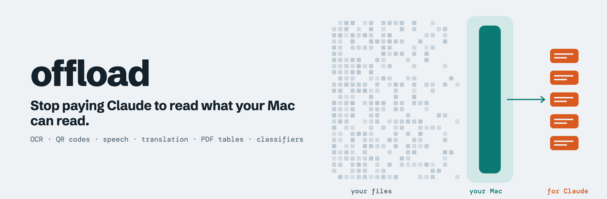

<p align="center">
  <picture>
    <source media="(prefers-color-scheme: dark)" srcset="docs/assets/hero-dark.png">
    
  </picture>
</p>

<p align="center">
  <a href="LICENSE"></a>
  
  
</p>

**offload** gives Claude Code the models already on your Mac. Point it at 5,000 screenshots or an hour of audio, and Claude reads the text that comes back instead of the raw files.

It suits Claude Code users on Apple Silicon whose jobs run to hundreds or thousands of files. For a dozen files, let Claude read them.

```console
$ cd ~/.claude/skills/offload/fixtures
$ offload ocr text.png
{"lines":["OFFLOAD TEST 2027"],"path":"text.png"}

$ offload look --ops barcode qr.png
{"path":"qr.png","barcodes":["https://example.com/offload"]}

$ offload transcribe speech.wav
{"path":"speech.wav","text":"Hello from Offload. This is a speech test. The sentence runs long enough for the sound classifier to hear several seconds of a human voice talking.","seconds":0.24}
```

## Requirements

- macOS 27 on Apple Silicon. We have tested it on macOS 27.0.1 with an M1 Max, and nothing else yet.
- Claude Code, for the skill and `offload map`. The `offload` command runs without it.
- Apple Intelligence turned on, for `generate` and `tag` only.
- Translation languages added in System Settings, for `translate` only.

You don't need Xcode, git, Homebrew, Python or Node. The program ships inside the skill.

## Install

```sh
curl -fsSL https://raw.githubusercontent.com/BraedenBDev/offload/main/install.sh | sh
```

This puts the skill in `~/.claude/skills/offload` and links `offload` into `~/.local/bin` for your own terminal. Then `offload setup` checks what each command needs, downloads the models, and opens System Settings where you need to turn something on. Run it again any time with `offload setup`. If your shell can't find `offload`, add `~/.local/bin` to your `PATH`. Claude doesn't need that, because the skill calls its own copy by full path.

Check everything works on your Mac:

```sh
~/.claude/skills/offload/scripts/selftest.sh
```

A `SKIP` line names a setting you haven't turned on, and isn't a failure. To remove offload, delete `~/.claude/skills/offload` and `~/.local/bin/offload`.

After that, start a new Claude Code session and ask it to do something large. The skill tells it to reach for `offload` first. New here? The [getting started guide](docs/getting-started.md) walks through three real jobs.

Rerun the same command to update.

**Prefer a Claude Code plugin?** Claude Code clones plugins with git, so a fresh Mac needs Apple's command line tools first (`xcode-select --install`). The program still comes bundled.

```sh
claude plugin marketplace add BraedenBDev/offload
claude plugin install offload@offload
```

**Using another agent?** `npx skills add BraedenBDev/offload` installs the skill for agents that support the [Agent Skills format](https://agentskills.io/specification). It needs Node, and we haven't tested this route.

## What it does

| You have | Run | You get |
|---|---|---|
| Screenshots, photos, video frames | `offload ocr` | The text in them |
| Images with QR codes | `offload look --ops barcode` | The exact link |
| Voice notes, calls, video audio | `offload transcribe` | A transcript |
| Foreign-language text | `offload translate` | English, or any installed language |
| PDFs and scans | `offload doc` | Text, tables and lists |
| Messy text | `offload extract` | Links, dates, phone numbers, names |
| A few thousand labelled rows | `offload train-text`, `offload predict` | Your own classifier, free to run |
| Near-duplicate images | `offload similar` | Matching pairs |

Batch commands take `--out results.jsonl`, so an interrupted job picks up where it stopped. They skip finished work and retry failures. See the [command reference](docs/commands.md).

## Test results

We ran these on one M1 Max against a private library of about 8,500 short videos and posts.

| Task | Result |
|---|---|
| Transcription | 288 s of audio in 6 s, against 41 s for whisper.cpp medium.en, with 94 to 97% word agreement |
| OCR | 70 to 300 images a minute with 4 jobs, depending on what else the Mac is doing |
| QR codes | 13 to 50 images a second |
| Training a classifier | 7,576 rows in 17 s, then under 1 ms a prediction. It scored 20 of 25 on human labels, level with the paid API that supplied its training labels |
| On-device summaries against Haiku | Haiku kept 52 numbers to the on-device model's 33 across 16 posts, so extraction stays with Haiku |

The samples are small and come from one machine, so test on your own data. Results, limits and failures sit in [capabilities.md](skills/offload/references/capabilities.md), and `make bench` runs a synthetic check on your Mac. We haven't yet measured a full-job token saving, and won't quote one until we have.

## Pick the cheapest tool that works

The skill gives Claude this order:

1. **A script**, for counting, filtering and joining.
2. **`offload`**, free and on-device, for reading and transforming.
3. **A classifier you trained**, for sorting thousands of rows.
4. **Haiku through `offload map`**, for writing and extraction where details matter.
5. **Sonnet or larger**, for synthesis, reading the cheaper step's output.

Each step feeds the next. Haiku reads local OCR text instead of images, and Sonnet reads Haiku's results instead of raw transcripts.

## Run Claude over a whole file

`offload map` sends rows to any Claude model in batches, with tools switched off because the content is untrusted. It resumes after interruptions and stops at usage limits.

```sh
offload map \
  --in rows.jsonl --out results.jsonl \
  --system @prompt.txt --schema item.json --model haiku
```

## What not to expect

Apple's on-device text model failed several of our tests:

- It named the wrong tool when reading an image, and invented a website.
- It scored 14 of 25 as a classifier.
- Safety filters blocked 9 of 24 harmless posts when we asked for JSON.
- Its summaries dropped recipe steps and numbers.

Apple's newer `RecognizeTextRequest` found about half the words of the older OCR API on our dense test images, under every setting we tried, so `offload ocr` uses the older API.

`generate` still works for rough gists and for data that must stay on your Mac. Image generation returned `notSupported` from a command-line tool, so offload leaves it out.

## Privacy and safety

`offload` commands run on your Mac, except `offload map`, which sends rows to Anthropic as any Claude Code session does. Text pulled from images and audio can contain instructions aimed at an AI, so treat it as data and never run what extraction finds. See [SECURITY.md](SECURITY.md).

offload calls Apple's public frameworks and doesn't use the `fm` command. Check Apple's macOS licence for your own use, including its terms on on-device models.

## Prior art

Other projects cover parts of this, and some may suit you better:

- [apfel](https://github.com/Arthur-Ficial/apfel) puts the on-device text model on the command line, and [ohr](https://github.com/Arthur-Ficial/ohr) does the same for speech.
- [mac-ocr](https://github.com/privatenumber/mac-ocr) and [macos-vision-mcp](https://github.com/woladi/macos-vision-mcp) focus on OCR.
- [claude-code-apple-skills](https://github.com/rshankras/claude-code-apple-skills) helps you build Apple apps, which is a different job.

offload combines the batch tools, the routing skill and the published test results in one install.

## Documentation

| Read | For |
|---|---|
| [Getting started](docs/getting-started.md) | Three worked jobs, and fixes for common problems |
| [Command reference](docs/commands.md) | Every command, option and exit code |
| [Capabilities](skills/offload/references/capabilities.md) | What we tested, what failed, and the limits |
| [Security](SECURITY.md) | What leaves your Mac, and how untrusted content is handled |

## Contributing

Results from other Macs help most. Run the self-test, then [open an issue](.github/ISSUE_TEMPLATE/test-results.md) with your numbers. See [CONTRIBUTING.md](CONTRIBUTING.md).

## Licence

[MIT](LICENSE)
